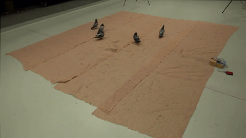
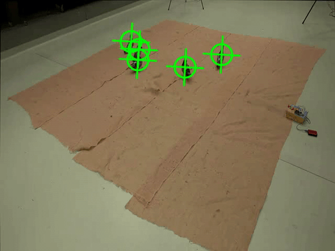

# TracktorLive Tutorial 9: Tracking with YOLO

## Goal

Under the hood, TracktorLive uses
[Tracktor](https://doi.org/10.1111/2041-210X.13166), which itself works using
classical computer vision methods. However, sometimes you might want to use more
advanced tracking methods, such as the plethora of deep-learning tools available
today. TracktorLive's modular architecture allows its core tracker to be
swappable, supporting a Bring-Your-Own-Tracker approach. We demonstrate this
here using [YOLO](https://docs.ultralytics.com/), a state-of-the-art detection
library used today.

The video relevant to this tutorial shows pigeons in an arena more complex than those we may
have encountered in previous tutorials. The view is also not top down.

Tracktor would struggle to identify pigeons in this view, and would likely fail
in distinguishing them from other objects in the arena.
For this readon we turn to YOLO.
To function, YOLO models need a '.pt' file, a pre-training files containing the
weights of the deep neural network used for image analysis.
The video and model used in this tutorial come from two related projects:

- **3D-POP**: Naik, H., Chan, A. H. H., Yang, J., Delacoux, M., Couzin, I. D.,
  Kano, F., & Nagy, M. (2023). **3D-POP: An automated annotation approach to
  facilitate markerless 2D-3D tracking of freely moving birds with marker-based
  motion capture.** In _2023 IEEE/CVF Conference on Computer Vision and Pattern
  Recognition (CVPR)_ (pp. 21274-21284). IEEE. [URL](https://cvpr.thecvf.com/virtual/2023/poster/21457)

- **3D-MuPPET:** Waldmann, U., Chan, A. H. H., Naik, H., Nagy, M., Couzin, I.
  D., Deussen, O., ... & Kano, F. (2024). **3D-MuPPET: 3D multi-pigeon pose
  estimation and tracking.** _International Journal of Computer Vision_, 132(10),
  4235-4252. [URL](https://link.springer.com/article/10.1007/s11263-024-02074-y)

The 3D-MuPPET project uses `YOLO_Barn.pt` as its default pretrained Ultralytics
YOLO checkpoint. This demonstration uses that model for generating 2D bounding boxes,
and the .pt file is provided in this folder.

## Method

The script for understanding this tutorial is `main.py`. Two key changes from
previous tutorials are needed:

1. The server is now initiated with the additional argument,
   `internal_tracking=False`. This argument makes it so that all default
   functionality beyond reading in a frame from the camera/video are completely
   switched off. This provides users a chance to implement their own tracker and
   pass it to the Tracktor Server as a cassette.

2. We then use the [YOLO server tracking](../../Library_Of_Casettes/YOLO_Server_Tracking/YOLO_server_tracking.md)
    cassette to replace the default internal tracking of TracktorLive. Moreover,
    we have used a custom 'Rotating Crosshairs' cassette to show the locations
    of tracked individuals.

Together, these steps enable deep-learning-based tracking within the framework
of TracktorLive. As in earlier tutorials, changing the video input to, e.g.,
`0`, and adding the argument `realtime=True`, would allow this tutorial to be
run with real-time inputs.

## Explanation

By providing a .pt file, users can use TracktorLive with YOLO instead of the
default Tracktor tracker. This serves to establish that other tracking
approaches are compatible with our software, and moreover, that existing
cassettes can still be used with these other trackers. Depending on the need,
advanced users can swap-in other trackers into their code and retain much of the
uses of TracktorLive.

Users can also directly use the code provided here by changing `YOLO_Barn.pt` to
other .pt files relevant to their study systems. Please refer to the [YOLO
documentation](https://docs.ultralytics.com/) for details on how to annotate
data and generate .pt files.
