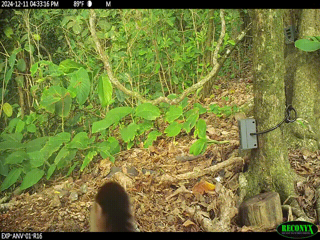
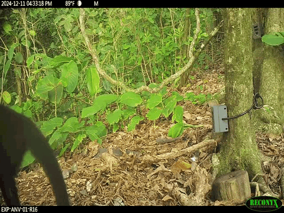
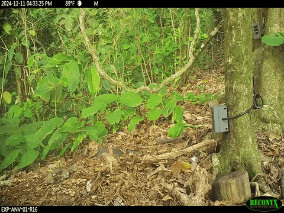
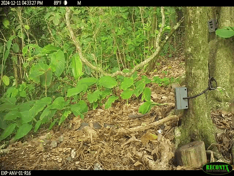

# TracktorLive Tutorial 10: Integrating an LLM

## Goal

TracktorLive's architecture makes it versatile, and can allow applications
beyond tracking animals and responding to their tracked locations. Here, we
demonstrate the integration of a locally run large language model (LLM) to
detect the presence of capuchin monkeys in video from a camera trap.

The video relevant to this tutorial comes from [Brendan
Barrett](https://sites.google.com/view/brendanbarrett/home), and was captured by
one of his group's camera traps deployed in Panama:

We use an LLM, [Google's Gemma-3 with 4 Billion Parameters
(gemma3:4b)](https://ollama.com/library/gemma3:4b), to detect the presence of
capuchin monkeys in the current frame. We then perform chunking as in [Tutorial
7](../08-video-chunking) based on the presence of these monkeys in the frame. In
a real-time setting, this would create a camera trap that would only turn on
recordings when capuchin monkeys were present in line-of-sight.

## Method

The script for understanding this tutorial is `monkey_detector.py`. As in [Tutorial
9](../09-deep-learning-based-tracking), we initialise the server with the
argument `internal_tracking=False`. This is because we are not really tracking
the monkeys that appear in this video.

We then use the python package `ollama` to run a vision-capable LLM, gemma3:4b,
locally on the computer running the server. Every 1.5 seconds, this LLM is shown
the current frame processed by the server, along with the prompt: `'Is there
a monkey in the picture? Base your decision ONLY on the photograph. Respond with
exactly YES or NO.'`. Depending on the LLM's response, the cassette then toggles
`server.keepvideo` so that video is only saved when monkeys are detected in
frame. For this specific use case, we run the
[LLM-use-detect](../../Library_Of_Casettes/LLM_Use_Detect/llm-use-detect.md)
cassette.

(... and so on)

As shown, the cassette does well at identifying the presence of monkeys and
chunking the video based on these detections.

## Explanation

Using an LLM, users can analyse videos as well as respond in real-time , most
often without the need for any training data. For instance, here, we did not
need any annotated bounding-boxes for the system to identify what a capuchin
monkey was. Incidentally, more complex prompts, for example asking if the monkey
were performing a certain behaviour, are also possible. LLMs even grant the
ability to be more vague, for example saying "does this frame show anything
unusual", to only see rare sightings and rare behaviours. 

The ability of vision-capable LLMs varies significantly. The
[SmolVLM](https://huggingface.co/blog/smolvlm) family has been demonstrated on
Raspberry Pi devices, and can thus prove useful for field deployments, or
parallel monitoring of wide areas. More complex models, such as the [Qwen
VL](https://huggingface.co/Qwen/Qwen3-VL-8B-Instruct) have been shown to detect
scene context from multiple frames, and may be useful for identifying rare
behaviours or specific interactions between animals. Experimenting with
different open-weights models is recommended before deciding which one to use.

Finally, we note that LLM behaviour varies significantly between trials, and
LLMs parse prompts differently and can vary in performance based on the tone and
capitalisation of the prompt. We recommend extensive trialling and
experimentation before you use LLMs with your experimental setups.
